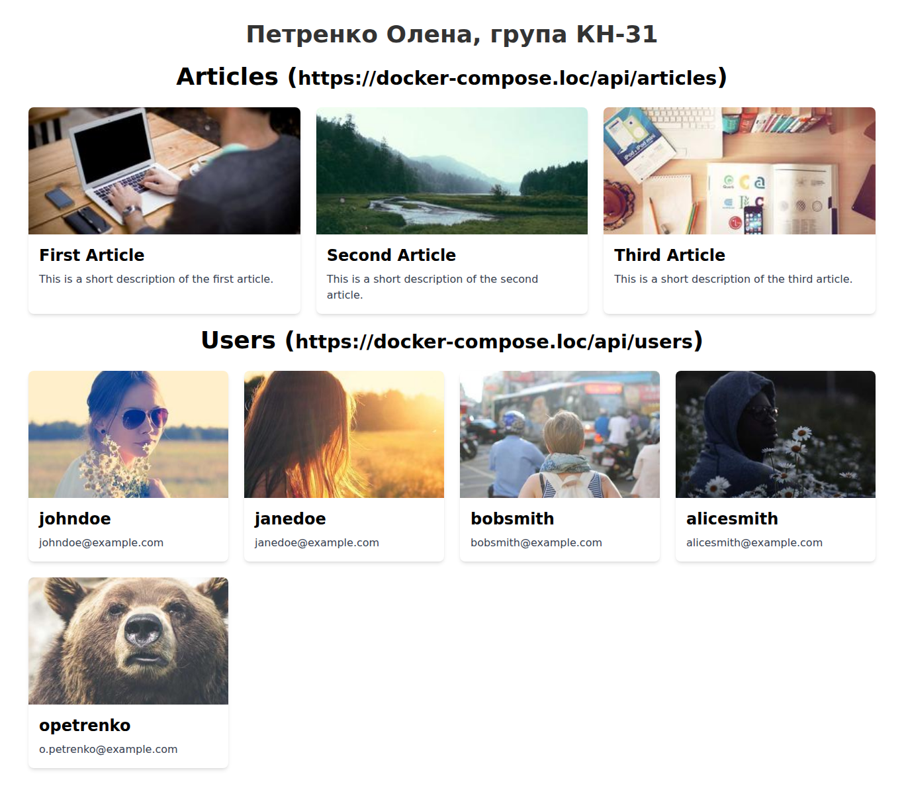

# Docker Compose — стартер лабораторної 6

Стартер містить багатоконтейнерний застосунок. Сторінка Vue отримує статті
від API на Flask і список користувачів від API на PHP, а PHP читає дані
з MySQL. Усі запити браузера приймає Nginx за адресою
`https://docker-compose.loc`. Код застосунку готовий, а опис його запуску
у файлі `compose.yaml` створюєте ви. Повний хід роботи та вимоги до звіту
наведено в Moodle.



## Отримання коду

У Linux, macOS або WSL, у робочому каталозі без наявного `lab6`:

```bash
git clone --depth 1 https://github.com/lisnayk/znu-lab-starters.git
cp -R znu-lab-starters/conteinerization/labs/06-compose/starter lab6
cd lab6
```

## Склад стартера

| Шлях | Призначення |
|---|---|
| `frontend/` | Застосунок Vue. Команда `npm run build:all` встановлює залежності й збирає статичні файли в `frontend/dist`. Адреси API підставляються під час збирання зі змінних `VITE_ARTICLES_URL` і `VITE_USERS_URL`. |
| `nginx/nginx.conf` | Конфігурація вебсервера. Сервер віддає статичні файли, передає `/api/articles` до `python-app:5000`, а `/api/users` до `php-app:80`, і перенаправляє HTTP на HTTPS. |
| `python_app/` | API статей на Flask. Залежності перелічено в `requirements.txt`. |
| `php_app/index.php` | API користувачів. Параметри підключення до бази читаються зі змінних `DB_HOST`, `DB_NAME`, `DB_USER` і `DB_PASS`. |
| `php_app/init/db.sql` | Скрипт, який створює базу `mydb` і таблицю `users` з початковими записами. |
| `.env.example` | Зразок змінних для `compose.yaml`. |

## Що потрібно створити

1. `python_app/Dockerfile`. Функція `app.run()` у `app.py` запускає сервер
   розробки лише на адресі `127.0.0.1`, тому в контейнері сервер потрібно
   запустити на `0.0.0.0:5000`.
2. `compose.yaml` із сервісами `certboot`, `frontend-build`, `web`,
   `python-app`, `php-app` і `mysql`. Конфігурація Nginx очікує сертифікат
   і ключ у файлах `/etc/nginx/certs/server.crt` та
   `/etc/nginx/certs/server.key`, а статичні файли — у каталозі
   `/usr/share/nginx/html`.
3. Файл `.env` з `.env.example` із власними паролями. Файл `.env` не
   додають до Git.

Своє ім’я та групу вкажіть у заголовку `frontend/src/App.vue`, а власний
запис додайте до `php_app/init/db.sql`.

## Підготовка середовища

Потрібні Docker Engine або Docker Desktop із командою `docker compose`.
Стартер перевірено з Docker Engine 29.9 та Docker Compose 5.7 у WSL 2.

Порти 80 і 443 на комп’ютері мають бути вільні. Додайте до файла `hosts`
рядок

```text
127.0.0.1 docker-compose.loc
```

У Linux і macOS це файл `/etc/hosts`, у Windows —
`C:\Windows\System32\drivers\etc\hosts`, який редагують від імені
адміністратора. Якщо браузер запущено у Windows, а Docker працює у WSL,
запис потрібен у файлі Windows.

## Запуск і перевірка

```bash
docker compose config
docker compose up -d --build
docker compose ps --all
```

Задачі `certboot` і `frontend-build` мають завершитися з кодом 0, решта
сервісів — працювати. Сертифікат самопідписаний, тому браузер покаже
попередження, яке для цієї адреси потрібно прийняти. API можна перевірити
з термінала.

```bash
curl -k https://docker-compose.loc/api/articles
curl -k https://docker-compose.loc/api/users
```

Скрипт `db.sql` виконується лише під час першого запуску з порожнім томом
бази. Щоб застосувати змінений скрипт, видаліть ресурси проєкту разом
із томами й запустіть його знову.

```bash
docker compose down --volumes
docker compose up -d --build
```
